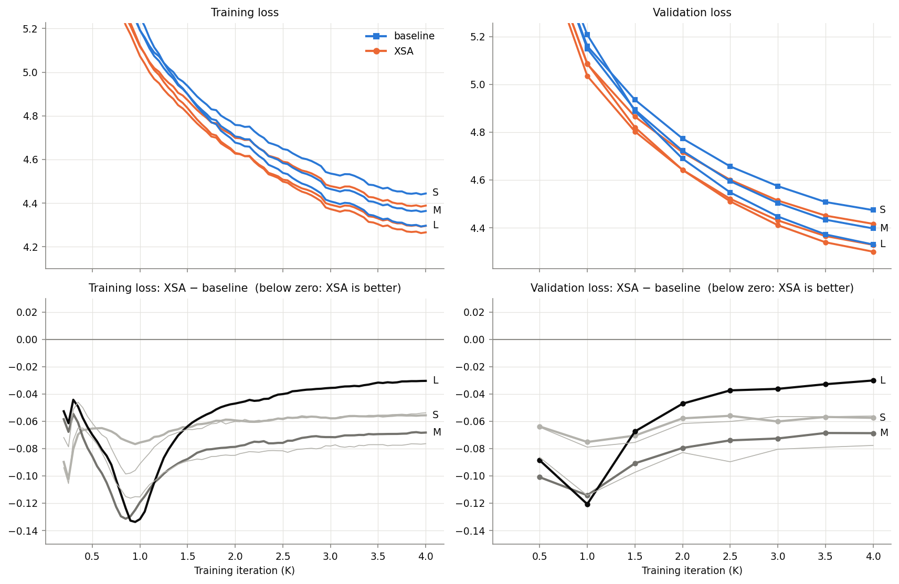
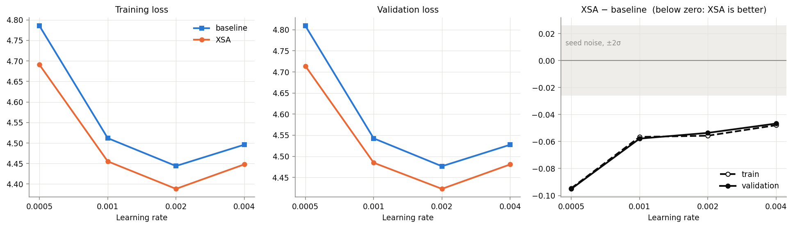
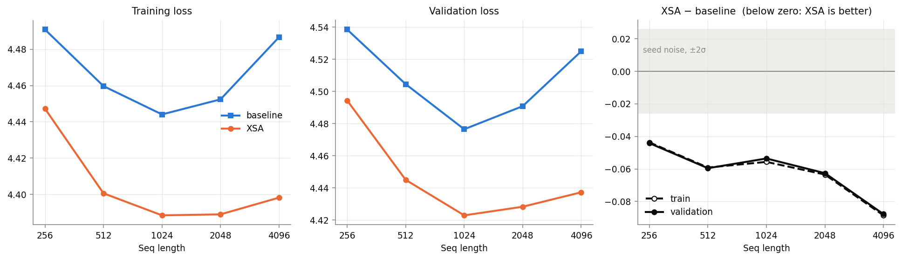
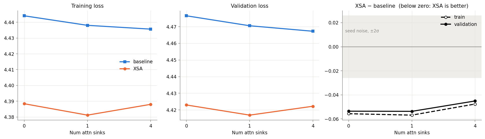
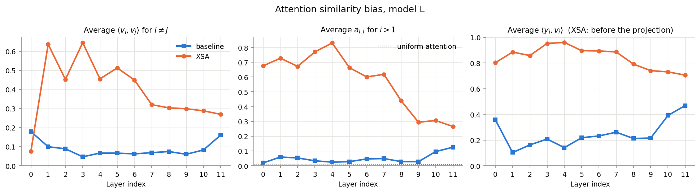
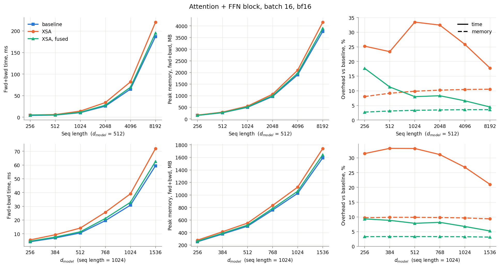

# ДЗ-2. Воспроизведение статьи «Exclusive Self Attention»

Статья: Shuangfei Zhai, *Exclusive Self Attention*, [arXiv:2603.09078](https://arxiv.org/abs/2603.09078). Презентация с разбором статьи — `presentation.pptx`.

В статье к обычному causal self-attention (SA) добавляется один шаг: из выхода внимания каждой головы `y_i` вычитается его проекция на собственный value-вектор токена `v_i`:

```
z_i = y_i − (y_iᵀ v_i) · v_i / ‖v_i‖²
```

Автор называет это exclusive self attention (XSA) и утверждает, что оно улучшает языковую модель почти бесплатно. В статье используются модели на 0.7–2.7B параметров и 100B токенов на прогон. У меня RTX 4070 SUPER, поэтому я повторяю те же эксперименты, но с более компактными моделями: 10–85M параметров и 65M токенов на прогон.

## Кратко

Δ = loss(XSA) − loss(baseline). Отрицательное значение значит, что XSA лучше. S, M и L — три размера моих моделей (small, medium, large): 10.6M, 25.2M и 85.0M параметров без эмбеддингов.

| № | Утверждение статьи | В статье | У меня | Вывод |
|---|---|---|---|---|
| 1 | У обычного SA выход внимания похож на собственный value-вектор токена (Fig. 1) | cos(y_i, v_i) 0.2–0.55, растёт с глубиной | 0.10–0.47 у модели L, максимум в последнем слое | воспроизвелось |
| 2 | Overhead XSA минимальный (Fig. 2) | время fwd+bwd ≈ +10…17%, память ≈ +8% | время +18…33%, память +8…10% (формула статьи, eager) | порядок величины тот же, но «минимальным» это не назвать; цена зависит от реализации |
| 3 | XSA даёт ниже train и val loss на всех размерах (Fig. 3) | Δ ≈ −0.02 | S −0.061 ± 0.013 (3 сида), M −0.067, L −0.030 | воспроизвелось; с размером модели отрыв не растёт |
| 4 | Отрыв сохраняется при разных learning rate (Fig. 4) | −0.020…−0.023, почти постоянный | −0.047…−0.095, сужается с ростом lr | знак воспроизвёлся, постоянство нет |
| 5 | Отрыв растёт с длиной контекста (Fig. 5) | −0.016 (512) → −0.027 (16384) | −0.044 (256) → −0.088 (4096) | воспроизвелось, но на одном сиде на точку |
| 6 | Отрыв сохраняется с attention sinks (Fig. 6) | ≈ −0.02 при 0, 1 и 4 sink-токенах | −0.054 / −0.054 / −0.045 | воспроизвелось |
| 7 | XSA лучше на 8 downstream-задачах (Table 2) | +0.26…+1.36 п.п. | не воспроизводил | см. «Что не воспроизводилось» |

Что сделано сверх статьи:

- статистики Fig. 1 посчитаны и для XSA-моделей: они отдают собственному токену 31–57% веса внимания против 4–5% у baseline (раздел 5);
- абляция с запретом смотреть на себя: выигрыш даёт проекция, а не маска (раздел 7);
- overhead измерен в обучении целой модели, а не только блока: −10% токенов/с у S и M, −17% у L (раздел 6);
- версия XSA с ручным backward: надбавка блока +4…9% по времени вместо +18…33% (раздел 6).

## Окружение

| | |
|---|---|
| GPU | NVIDIA GeForce RTX 4070 SUPER, 12 GiB |
| Драйвер | 617.42 |
| PyTorch / CUDA / cuDNN | 2.10.0+cu130 / 13.0 / 9.12.0 |
| Python | 3.13.11 |


Всё считалось в eager-режиме, без torch.compile. Это не влияет на результаты, но добавляет overhead. 

## Как воспроизвести

```bash
pip install torch numpy pandas matplotlib
cd hw2
python data.py           
python model.py     
python xsa_fast.py        # gradcheck версии XSA с ручным backward
python bench_overhead.py  # Fig. 2 -> results/overhead.csv, results/overhead_kernels.csv
python sweep.py           # 30 прогонов, ~5.8 ч на RTX 4070 SUPER -> results/runs/
python plots.py           # графики -> results/figures/, таблицы -> results/tables.md
```

## Файлы

| Файл | Содержимое |
|---|---|
| `presentation.pptx` | презентация с разбором статьи |
| `model.py` | GPT в стиле nanoGPT: RoPE, LayerNorm после эмбеддингов, флаг `xsa`, sink-токены, флаг `no_self` для абляции |
| `xsa_fast.py` | та же проекция XSA с выписанным вручную backward |
| `data.py` | скачивание токенизированного FineWeb |
| `train.py` | один прогон обучения, в конце считает статистики Fig. 1 |
| `bias.py` | статистики attention similarity bias по слоям |
| `sweep.py` | очередь всех прогонов |
| `bench_overhead.py` | время и память блока attention + FFN, число GPU-кернелов |
| `plots.py` | графики и таблицы |
| `results/runs/<имя>/` | `summary.json`, `log.csv` (train loss каждые 50 шагов), `eval.csv` (val loss каждые 500 шагов) |
| `results/tables.md` | все таблицы отчёта в одном файле |
| `results/overhead.csv`, `results/overhead_kernels.csv` | замеры блока и профиль GPU-кернелов |
| `results/sweep.log`, `results/bench.log` | логи очереди прогонов и бенчмарка |
| `results/figures/` | графики |

## Что как в статье, а что изменено

| | Статья | У меня |
|---|---|---|
| Код | nanoGPT + RoPE + LayerNorm после эмбеддингов, n_head и head_dim задаются независимо | так же, написано с нуля в `model.py` |
| Модели (без эмбеддингов) | 0.7B / 1.4B / 2.7B, 24–32 слоя | три размера: S (small) 10.6M — 6 слоёв, d_model 384; M (medium) 25.2M — 8 слоёв, d_model 512; L (large) 85.0M — 12 слоёв, d_model 768. Везде head_dim 64 |
| Данные | FineWeb-100BT, токенизатор GPT-2 | 200M токенов FineWeb с тем же токенизатором (2 шарда из `kjj0/fineweb10B-gpt2`) |
| Валидация | 0.05% токенов | первые 2^21 токенов val-шарда, одни и те же для всех прогонов |
| Контекст | 2048 | 1024 |
| Батч | 0.5M токенов | 16 384 токена |
| Длина обучения | 200K шагов ≈ 100B токенов | 4000 шагов ≈ 65.5M токенов |
| Оптимизатор | AdamW, warmup 2K шагов, cosine до 0.1·lr | AdamW (β = 0.9 / 0.95, weight decay 0.1), warmup 200 шагов, cosine до 0.1*lr, clip 1.0 |
| Learning rate | для каждого размера lr подбирают на baseline и с ним же обучают XSA; получилось 5e-4 / 4e-4 / 3e-4 | на baseline подобран только lr для S: 2e-3, XSA обучается с ним же. Для M и L перебора не было: lr уменьшен в той же пропорции 5 : 4 : 3, что и между моделями разного размера в статье, то есть 1.6e-3 и 1.2e-3 |
| Точность | bf16 | bf16 (autocast) |
| Бенчмарк overhead | B200, batch 32, d_model 2048 | RTX 4070 SUPER, batch 16, d_model 256–1536 |

Формула XSA в `model.py` — буквально Algorithm 1 из статьи:

```python
def exclude_self(y, v):
    vn = F.normalize(v, dim=-1)
    return y - (y * vn).sum(dim=-1, keepdim=True) * vn
```

## Протокол

- **Парное сравнение.** У XSA нет новых параметров, поэтому baseline и XSA с одним сидом стартуют с одинаковых весов и видят одинаковые батчи. Разница между ними — только сама проекция.
- **Метрики.** Train loss — среднее по последним 200 шагам. Val loss — на фиксированных 2²¹ токенах, нарезанных на окна длиной в контекст модели.
- **Шум.** Для основной конфигурации (S, контекст 1024) три сида. Стандартное отклонение парной разницы по ним — мера шума для остальных графиков, где сид один. На графиках это серая полоса ±2σ вокруг нуля.
- **Loss чанками.** Логиты 16 384 × 50 304 вместе с log-softmax и градиентами занимают около 10 ГБ. На 12 ГБ карте Windows при этом уходит в shared memory, и скорость падает с 125K до 45K токенов/с. Поэтому голова и loss считаются по 2048 токенов: градиент по скрытому состоянию копится и затем одним вызовом уходит в тело сети. Результат совпадает с обычным расчётом с точностью до округления bf16 (косинус между градиентами 0.999998).
- **Overhead.** Блок attention + FFN, как в статье. Время — медиана по `torch.cuda.Event`, три раунда с чередованием вариантов, чтобы дрейф температуры не попал в разницу. Память — `max_memory_allocated()` за один шаг. Число кернелов — `torch.profiler`.
- **Статистики Fig. 1.** На 256 последовательностях из val, в fp32, с явно посчитанной матрицей внимания.

## Результаты

Все числа ниже взяты из `results/tables.md`

### 1. XSA против baseline: сиды и размер модели (Fig. 3)

Модель S, контекст 1024, lr 2e-3, три сида:

| | train SA | train XSA | Δ train | val SA | val XSA | Δ val |
|---|---|---|---|---|---|---|
| seed 0 | 4.4441 | 4.3884 | −0.0557 | 4.4765 | 4.4230 | −0.0536 |
| seed 1 | 4.4327 | 4.3788 | −0.0538 | 4.4726 | 4.4200 | −0.0526 |
| seed 2 | 4.4506 | 4.3742 | −0.0764 | 4.4912 | 4.4159 | −0.0753 |
| среднее ± std | | | −0.0620 ± 0.0125 | | | −0.0605 ± 0.0128 |

XSA лучше во всех трёх парах, средняя разница почти в пять раз больше её разброса. Сам val loss между сидами гуляет на 0.010 у baseline и на 0.004 у XSA.

Три размера, по одному сиду:

| | train SA | train XSA | Δ train | val SA | val XSA | Δ val |
|---|---|---|---|---|---|---|
| S (lr 2e-3) | 4.4441 | 4.3884 | −0.0557 | 4.4765 | 4.4230 | −0.0536 |
| M (lr 1.6e-3) | 4.3639 | 4.2956 | −0.0683 | 4.4006 | 4.3339 | −0.0667 |
| L (lr 1.2e-3) | 4.2963 | 4.2659 | −0.0304 | 4.3364 | 4.3063 | −0.0301 |



Верхний ряд — кривые обучения, нижний — разница XSA − baseline по ходу обучения (тонкие линии — два дополнительных сида S).

- XSA показывает более высокие результаты на всех трёх моделях разного размера, прям как в статье
- Роста отрыва по мере роста модели нет: у L он вдвое меньше, чем у S и M. В статье рост выигрыша с размером показан на downstream-задачах, по loss он там не оценивается.
- У S разница стоит на отметке −0.057 начиная с 2000-го шага, у M медленно сужается и останавливается на −0.069 к 3500-му шагу. У L она сужается в течение всего обучения: −0.121 на 1000-м шаге, −0.030 на 4000-м, и к концу еще не остановилась
- У S и M отрыв втрое больше, чем в статье (−0.06 против −0.02), хотя модели на один–два порядка меньше. Мои модели находятся в самом начале обучения: loss 4.3–4.5 против 2.5 в статье, токенов в 1500 раз меньше. По траектории L видно, что отрыв со временем сужается. Поэтому из сравнения со статьей следуют только два вывода: XSA и у меня лучше baseline, и отрыв так же меняется при изменении условий (например, растет с длиной контекста). Саму величину размера отрыва (−0.06 у меня против −0.02 в статье) сравнивать нельзя: она зависит от того, как долго обучалась модель
### 2. Learning rate (Fig. 4)

| lr | train SA | train XSA | Δ train | val SA | val XSA | Δ val |
|---|---|---|---|---|---|---|
| 5e-4 | 4.7852 | 4.6906 | −0.0945 | 4.8091 | 4.7141 | −0.0950 |
| 1e-3 | 4.5119 | 4.4553 | −0.0566 | 4.5426 | 4.4848 | −0.0578 |
| 2e-3 | 4.4441 | 4.3884 | −0.0557 | 4.4765 | 4.4230 | −0.0536 |
| 4e-3 | 4.4958 | 4.4479 | −0.0479 | 4.5275 | 4.4808 | −0.0467 |



XSA лучше при каждом lr, и оптимум у обоих вариантов один и тот же (2e-3) — это совпадает со статьёй. «Почти постоянного» отрыва нет: при самом низком lr он вдвое больше, чем при самом высоком. Это согласуется с предыдущим пунктом: при lr 5e-4 обе модели за 4000 шагов обучились хуже всего, а чем раньше стадия обучения, тем больше отрыв. В статье тенденция та же, но слабая (−0.023 при 1e-4 против −0.020 при 4e-4).

### 3. Длина контекста (Fig. 5)

Число токенов в батче постоянное, как в статье, поэтому с ростом контекста последовательностей в батче становится меньше.

| Контекст | Батч | train SA | train XSA | Δ train | val SA | val XSA | Δ val |
|---|---|---|---|---|---|---|---|
| 256 | 64 | 4.4909 | 4.4472 | −0.0437 | 4.5386 | 4.4944 | −0.0441 |
| 512 | 32 | 4.4597 | 4.4005 | −0.0591 | 4.5046 | 4.4450 | −0.0595 |
| 1024 | 16 | 4.4441 | 4.3884 | −0.0557 | 4.4765 | 4.4230 | −0.0536 |
| 2048 | 8 | 4.4524 | 4.3889 | −0.0634 | 4.4909 | 4.4283 | −0.0626 |
| 4096 | 4 | 4.4867 | 4.3982 | −0.0885 | 4.5250 | 4.4373 | −0.0877 |



- Отрыв XSA вырос вдвое от контекста 256 к 4096. В статье картина та же: −0.016 на 512 и −0.027 на 16384
- На точку один сид, а шум ±0.013, поэтому соседние точки неразличимы (512 и 1024 идут даже в обратном порядке). Уверенно можно говорить только о разнице между краями
- В отличие от статьи, у baseline loss на длинных контекстах растёт: 4.477 на 1024 и 4.525 на 4096. Вероятная причина в том, что при 16K токенов в батче на контексте 4096 остаётся четыре последовательности (в статье при 0.5M токенов их не меньше тридцати). XSA на том же переходе теряет 0.014 вместо 0.049

### 4. Attention sinks (Fig. 6)

Sink-токены — это k обучаемых векторов, которые приписываются в начало каждой последовательности; loss на них не считается.

| Sink-токенов | train SA | train XSA | Δ train | val SA | val XSA | Δ val |
|---|---|---|---|---|---|---|
| 0 | 4.4441 | 4.3884 | −0.0557 | 4.4765 | 4.4230 | −0.0536 |
| 1 | 4.4380 | 4.3812 | −0.0568 | 4.4706 | 4.4169 | −0.0537 |
| 4 | 4.4356 | 4.3880 | −0.0476 | 4.4673 | 4.4222 | −0.0451 |



- Отрыв XSA сохраняется при любом числе sink-токенов, как в статье. Разница между −0.054 и −0.045 меньше шума
- Пользы от самих sink-токенов на взятых мною моделях не видно: baseline улучшается на 0.006 и 0.009 при разбросе между сидами 0.010. В статье они дают около 0.01 обоим вариантам
- Baseline отдает sink-токенам в среднем 4% веса внимания при одном токене и 8% при четырёх (до 18% в последнем слое). XSA-модель — 1% и 2%, при этом внимание к своей позиции у неё остаётся на уровне 27–29%. То есть явными sink-токенами она почти не пользуется: лишний вес внимания у неё уходит на свою позицию

### 5. Attention similarity bias (Fig. 1)

Три статистики из статьи, усреднённые по головам и по 256 последовательностям, для обученных моделей. Модель L ближе всего к статье по глубине:



Средние по слоям (графики для S и M — `results/figures/bias_S.png`, `bias_M.png`):

| | | cos(v_i, v_j) | a_ii | cos(y_i, v_i) | cos(z_i, v_i) |
|---|---|---|---|---|---|
| S | SA | 0.078 | 0.045 | 0.273 | 0.273 |
| S | XSA | 0.278 | 0.311 | 0.706 | 0.000 |
| M | SA | 0.079 | 0.045 | 0.277 | 0.277 |
| M | XSA | 0.310 | 0.432 | 0.782 | 0.000 |
| L | SA | 0.088 | 0.049 | 0.247 | 0.247 |
| L | XSA | 0.392 | 0.572 | 0.841 | 0.000 |

**Baseline — как в статье.** Диапазоны по слоям у модели L: cos(v_i, v_j) 0.05–0.18 (в статье 0.04–0.10), a_ii 0.02–0.13 (0.02–0.13), cos(y_i, v_i) 0.10–0.47 (0.22–0.54).

- **Токен смотрит на себя чаще, чем на остальных.** Если бы внимание делилось поровну между всеми видимыми токенами, на свою позицию приходилось бы около 0.6% веса (пунктир на среднем графике). На деле в зависимости от слоя выходит 2–13%, то есть в 3–20 раз больше.
- **К концу сети выход внимания всё больше похож на собственный value-вектор токена.** Во всех трёх моделях это сходство, cos(y_i, v_i), наибольшее в последнем слое: 0.42 у S, 0.47 у M и 0.47 у L. В статье так же: сходство растёт к последним слоям.
- **Отличие от статьи.** У меня сходство велико ещё и в самом первом слое (0.28–0.39), потом падает и снова растёт к последнему. В статье такого пика в начале нет: там первые слои самые низкие.

**XSA — этого в статье нет.** Автор пишет, что XSA может "сбрасывать" ненужное внимание к собственной позиции токена и работает как неявный attention sink, но не показывает этого. Мои измерения это подтверждают:

- Внимание к своей позиции вырастает в 7–12 раз в среднем по слоям: с 0.045 до 0.31 у S, до 0.43 у M и до 0.57 у L. В первых восьми слоях L на свой токен приходится 60–83% веса внимания
- До проекции выход внимания почти сонаправлен с собственным value-вектором: cos(y_i, v_i) в среднем 0.71–0.84. То есть большую часть y_i проекция вычитает
- Value-векторы разных токенов становятся заметно более сонаправленными: 0.28–0.39 против 0.08
- После проекции cos(z_i, v_i) = 0, как и должно быть

Эффект растёт с размером модели. Объяснить его просто: внимание к себе для XSA-модели бесплатно, потому что его вклад целиком лежит вдоль v_i и вычитается. Но из этого не следует, что выигрыш XSA получается за счёт такого сброса внимания, это проверяется абляцией.

### 6. Overhead (Fig. 2)

Блок attention + FFN, batch 16, bf16. Надбавка к baseline в процентах; XSA — формула из статьи, «XSA fused» — версия с ручным backward из `xsa_fast.py`. Замеры только forward — в `results/tables.md`.

| d_model | T | fwd+bwd baseline, мс | XSA | XSA fused | пик памяти baseline, МБ | XSA | XSA fused |
|---|---|---|---|---|---|---|---|
| 512 | 256 | 4.22 | +25% | +18% | 154 | +8% | +3% |
| 512 | 512 | 4.99 | +23% | +11% | 270 | +9% | +3% |
| 512 | 1024 | 10.63 | +33% | +8% | 502 | +10% | +3% |
| 512 | 2048 | 25.72 | +32% | +8% | 968 | +10% | +3% |
| 512 | 4096 | 65.09 | +26% | +7% | 1898 | +10% | +4% |
| 512 | 8192 | 186.99 | +18% | +4% | 3760 | +11% | +4% |
| 256 | 1024 | 4.25 | +31% | +9% | 254 | +10% | +3% |
| 384 | 1024 | 7.00 | +33% | +9% | 377 | +10% | +3% |
| 768 | 1024 | 19.59 | +31% | +8% | 759 | +10% | +3% |
| 1024 | 1024 | 30.81 | +27% | +7% | 1026 | +10% | +3% |
| 1536 | 1024 | 59.46 | +21% | +5% | 1592 | +9% | +3% |



**Формула из статьи.** +18…33% ко времени forward + backward и +8…10% к памяти. В статье по графику выходит примерно +10…17% и +8%, но там блок гораздо тяжелее (d_model 2048, T до 16384). Надбавка падает с ростом T и d_model: сам блок дорожает как T² и d², а добавка XSA — линейно. На T = 8192 у меня +18%, в статье на той же длине около +17%. 

Все замеры, как я уже упоминал, сделаны в eager-режиме. С `torch.compile` надбавка по времени, вероятно, была бы меньше, потому что он склеивает мелкие операции в один кернел

**Почему две строки кода стоят так дорого.** `torch.profiler` для блока с d_model 512 и T 1024:

| Вариант | Запусков кернелов за fwd+bwd | GPU занята, мс |
|---|---|---|
| baseline | 90 | 10.31 |
| XSA | 126 | 13.87 |
| XSA fused | 109 | 11.18 |

Матричные умножения и сам кернел внимания не меняются. Все 36 новых кернелов — поэлементные операции, редукции и копирования с приведением типа: поэлементных запусков 95 вместо 63, а GPU проводит в них 6.2 мс вместо 3.0. В профиле новые операции работают с float, и копирований bf16 ↔ fp32 становится 17 вместо 12: под autocast нормировка считается в fp32, и вместе с ней в fp32 оказываются промежуточные тензоры полного размера. Арифметики в этих операциях почти нет, время уходит на чтение и запись памяти.

**Версия с ручным backward.** В `xsa_fast.py` та же проекция записана как `z = y − c·v`, `c = ⟨y, v⟩ / ⟨v, v⟩`. Нормировки и fp32-тензоров полного размера нет, а backward выписан аналитически: `g_y = g − a·v`, `g_v = −c·g_y − a·z`, где `a = ⟨g, v⟩ / ⟨v, v⟩`.

- Математически это то же самое: `gradcheck` проходит, выход и градиенты совпадают с формулой статьи до 1e-15 в fp64.
- Надбавка по времени +4…9% при T ≥ 1024 и +3…4% по памяти. На T = 256 выигрыш меньше (+18% против +25%): там блок считается 4 мс и упирается в запуск кернелов, а не в их работу.
- В bf16 проекция чуть менее точная: средний |cos(z, v)| 1.6e-3 против 2.3e-4, потому что коэффициент `c` округляется до bf16.
- В обучении эта версия не использовалась: все результаты по loss получены с формулой статьи.

**Обучение целой модели.** Медиана скорости за прогон и пик памяти:

| | Параметры | Токенов/с SA | Токенов/с XSA | Δ | Пик памяти SA, GiB | Пик памяти XSA, GiB | Δ |
|---|---|---|---|---|---|---|---|
| S | 10.6M | 123.2K | 111.2K | −9.7% | 3.14 | 3.35 | +6.9% |
| M | 25.2M | 82.6K | 74.5K | −9.7% | 4.56 | 4.95 | +8.5% |
| L | 85.0M | 43.7K | 36.0K | −17.4% | 8.73 | 9.60 | +10.0% |

У S и M шаг обучения дорожает примерно на 11%, втрое меньше, чем блок (+31…33%): заметную часть шага занимают проекция в словарь на 50K токенов и softmax, которые XSA не трогает. У L тело сети занимает бо́льшую часть шага, и замедление ближе к блочному.

### 7. Абляция: запретить внимание к своей позиции

В статье этого эксперимента нет. Я решил его провести, так как он помогает ответить на два вопроса: достаточно ли просто не давать токену смотреть на себя, и нужна ли XSA своя позиция как место для сброса внимания. Запрет реализован с помощью маски: токен видит все предыдущие, но не себя (но первый токен видит себя, иначе ему не на что смотреть). Модель S, тот же lr, сид и батчи, что у основной пары.

**Итог:** выигрыш даёт именно проекция (около −0.05 и с маской, и без неё), а запрет смотреть на себя сам по себе почти ничего не меняет (−0.005…−0.009, меньше шума).

| | train | val | Δ val к SA | cos(v_i, v_j) | a_ii | cos(y_i, v_i) |
|---|---|---|---|---|---|---|
| SA | 4.4441 | 4.4765 | — | 0.078 | 0.045 | 0.273 |
| SA без внимания к себе | 4.4344 | 4.4676 | −0.0089 | 0.088 | 0 | 0.200 |
| XSA | 4.3884 | 4.4230 | −0.0536 | 0.278 | 0.311 | 0.706 |
| XSA без внимания к себе | 4.3839 | 4.4179 | −0.0587 | 0.302 | 0 | 0.500 |

Три правых столбца — средние по слоям, cos(y_i, v_i) у XSA посчитан до проекции.

Те же четыре val loss, разложенные по двум признакам:

| | без проекции | с проекцией | что даёт проекция |
|---|---|---|---|
| токен видит себя | 4.4765 (SA) | 4.4230 (XSA) | −0.054 |
| токен не видит себя (маска) | 4.4676 | 4.4179 | −0.050 |
| **что даёт маска** | −0.009 | −0.005 | |

Маска обнуляет только вес внимания a_ii, то есть убирает вклад собственного токена. Проекция убирает из выхода внимания всё, что направлено вдоль v_i, включая вклады других токенов с похожими value-векторами.

- **Одной маски недостаточно.** Запрет смотреть на себя даёт −0.009, это меньше шума между сидами (0.013) и в шесть раз меньше, чем даёт XSA. Выигрыш создаёт проекция.
- **XSA не нужна своя позиция.** С маской XSA не хуже, чем без неё (−0.059 против −0.054, незначительная разница). Значит, высокое внимание к себе у XSA-моделей скорее побочный эффект, а не причина его преимущества 
- **Similarity bias остаётся и без внимания к себе.** У baseline с маской cos(y_i, v_i) всё ещё 0.11–0.35 по слоям: выход внимания похож на собственный value-вектор токена за счёт value-векторов других токенов. У XSA с маской они остаются сильно сонаправленными (0.30 в среднем), и проекция по-прежнему вычитает заметную часть y_i

Оговорка: так как у нас по одному сиду на вариант, различия порядка 0.005–0.009 здесь ничего не значат. Важна только разница между парами с проекцией и без неё.

## Что не воспроизводилось

**Table 2 (8 downstream-задач через lm-evaluation-harness).** Модели на 10–85M параметров после 65M токенов имеют loss около 4.4 против 2.5 в статье. По моей оценке, на ARC, PIQA, HellaSwag и остальных задачах такие модели дали бы результат около случайного угадывания, поэтому сравнение вместо этого веду по val loss.

## Ограничения

- **Масштаб и стадия обучения.** Модели на один–два порядка меньше, токенов в 1500 раз меньше, loss 4.3–4.5 против 2.5. Это самое начало обучения, и по модели L видно, что отрыв XSA со временем сужается
- **Сиды.** Три сида только у одной конфигурации (S, контекст 1024). Во всех остальных точках, включая абляцию, сид один, а шум оценён по S и перенесён на остальные.
- **Learning rate** подобран только для S. Для M и L он взят пересчётом, поэтому сравнение размеров между собой слабее, чем сравнение SA и XSA внутри одного размера.